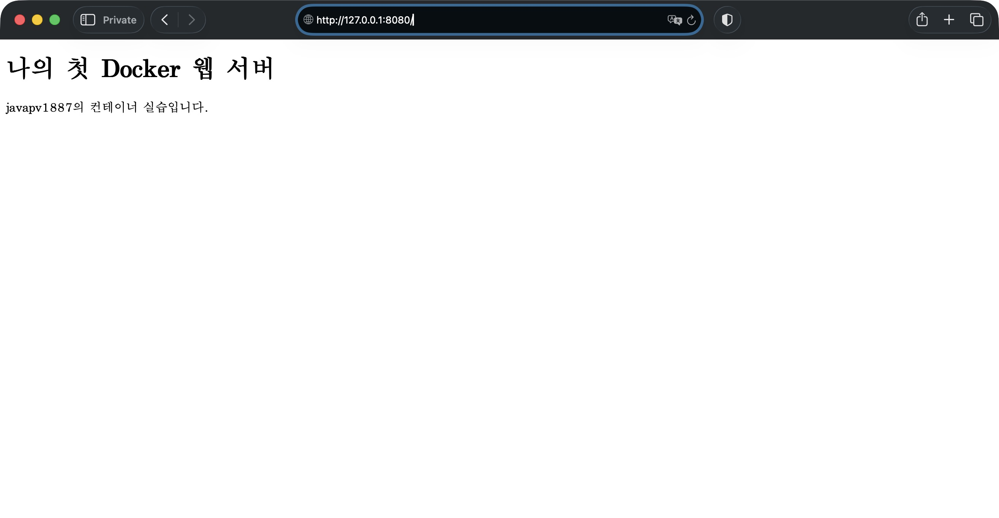
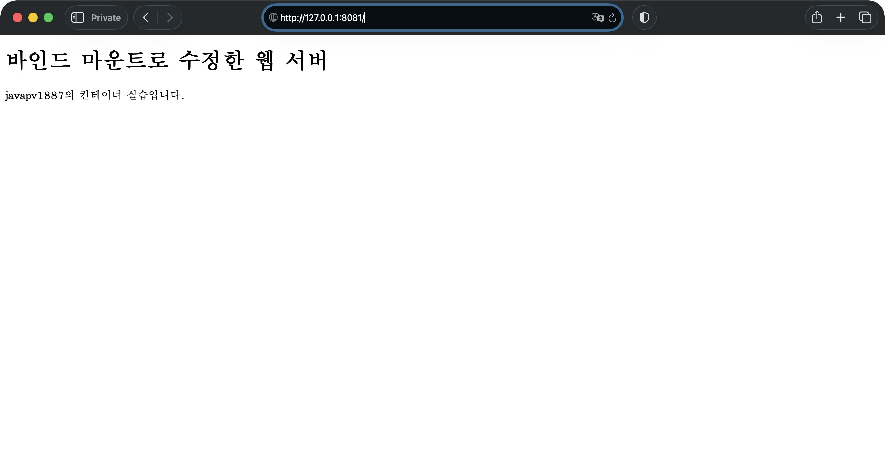
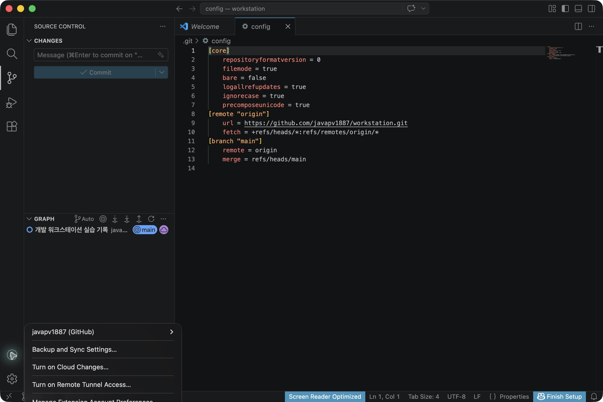

# 개발 워크스테이션 구축

## 1. 프로젝트 개요

터미널로 파일과 권한을 다루고, Docker로 웹 서버를 실행하며, 수행 과정과 검증 결과를 GitHub 저장소에 기록하는 과제다.

터미널·권한 실습, Docker 컨테이너 운영과 `attach` / `exec` 비교, Dockerfile 웹 서버 실행과 포트 매핑을 마쳤다. 바인드 마운트의 변경 반영과 컨테이너 삭제 후 Docker 볼륨의 데이터 유지도 확인했다. 체크리스트는 아래 증거로 확인한 항목을 완료로 표시했다.

## 2. 실행 환경

| 항목 | 확인 결과 |
| --- | --- |
| 운영체제 | macOS 26.3.1 |
| CPU 아키텍처 | Apple Silicon, `arm64` |
| 셸 | zsh 5.9 |
| 터미널 | macOS Terminal |
| Docker CLI | 29.9.2, build `a82e528` |
| Docker 서버 | 29.9.2, Linux / `aarch64` |
| Docker Compose | v5.6.1 |
| Ubuntu 실습 이미지 | `ubuntu:24.04` / 로그의 버전 표시: Ubuntu 24.04.5 LTS |
| 웹 서버 베이스 이미지 | `nginx:alpine` |
| 커스텀 웹 서버 이미지 | `ws-web:1.0` |
| 실습 웹 서버 버전 | HTTP 응답의 `nginx/1.31.8` |
| Git | 2.50.1, Apple Git-155 |
| Git 작성자 이름 | `javapv1887` |
| Git 작성자 이메일 | `351423688+javapv1887@users.noreply.github.com` |
| Git 기본 브랜치 설정 | `main` |

운영체제·셸·도구 버전과 Git 설정은 문서를 정리하면서 Codex가 읽기 전용 명령으로 확인했으며, [환경 점검 로그](evidence/logs/environment-check.txt)에 보관했다. Docker 버전·엔진 동작과 `hello-world` 실행은 직접 실습했고, [Docker 기본 실습 정리 로그](evidence/logs/docker-basic-clean.txt)에 명령과 실제 출력을 기록했다.

## 3. 수행 체크리스트

- [x] 과제 폴더와 실습·증거 저장 폴더 준비
- [x] 현재 위치 확인, 폴더 이동, 숨김 항목을 포함한 목록 확인
- [x] 빈 파일 생성, 파일 내용 작성·확인
- [x] 파일 복사, 이름 변경, 삭제 및 결과 확인
- [x] 실행 환경 버전과 Git 작성자·기본 브랜치 설정 확인
- [x] 실제 오류 3건의 문제·원인 가설·확인·해결 또는 대응 기록
- [x] 파일 1개와 디렉터리 1개의 권한 변경 전후 비교
- [x] Docker 버전·엔진 동작 점검 로그 정리
- [x] Docker 이미지와 전체 컨테이너 목록 확인
- [x] `hello-world` 실행 성공 로그 첨부
- [x] 이미지 다운로드 과정 기록
- [x] Ubuntu 컨테이너 내부 명령 실습 기록
- [x] 종료된 컨테이너의 로그 확인 (`docker logs`)
- [x] 컨테이너 재시작·중지·실행 중 목록·리소스 확인 (`docker start`, `docker stop`, `docker ps`, `docker stats`)
- [x] `attach` / `exec`와 컨테이너 종료·유지 차이 관찰
- [x] 직접 작성한 Dockerfile과 웹 서버 소스 준비
- [x] 베이스 이미지 선택 이유와 커스텀 포인트의 목적 설명
- [x] 이미지 빌드·컨테이너 실행 및 포트 매핑 검증
- [x] 주소창과 포트가 보이는 브라우저 접속 증거 첨부
- [x] 바인드 마운트 변경 전후 비교
- [x] 컨테이너 삭제 전후 Docker 볼륨 데이터 유지 검증
- [x] 과제 폴더의 Git 저장소 초기화와 커밋
- [x] GitHub 저장소 연결·업로드 및 VS Code 연동 증거 첨부
- [x] README 재현 절차·증거 링크 점검 및 제출 URL 준비

## 4. 터미널 기본 실습

### 기록을 읽는 방법

- 개인 경로가 포함된 터미널 원본은 실습한 Mac에 보관했다. 제출 저장소에는 README에서 연결한 공유용 로그와 캡처를 포함했다.
- 아래 코드블록은 직접 수행한 터미널 기록의 발췌다. 전체 기록은 [터미널 실습 로그](evidence/logs/terminal-practice.txt)에서 확인할 수 있다.
- 프롬프트는 `$`로 통일하고, 사용자명은 `<USER>`, 홈 경로는 `<HOME>`, 과제 폴더의 절대경로는 `<PROJECT_ROOT>`로 가렸다. 이 표시는 명령어 그대로 복사할 값이 아니다.
- 다른 컴퓨터에서 따라 할 때는 `<PROJECT_ROOT>`를 자신의 과제 폴더 절대경로로 바꾸고, `README.md`가 있는 폴더에서 시작한다.
- 목록과 파일 크기는 실습 당시의 출력이다. README 편집 후의 크기나 폴더 목록과는 다를 수 있다.

### 4.1. 작업 폴더 생성과 현재 위치 확인

```text
$ mkdir -p "<PROJECT_ROOT>"
$ cd "<PROJECT_ROOT>"
$ pwd
<PROJECT_ROOT>
$ touch README.md
$ mkdir -p practice/terminal evidence/logs evidence/images site
```

실습 파일은 `practice/terminal`, 텍스트 증거는 `evidence/logs`, 화면 증거는 `evidence/images`, 웹 서버 콘텐츠는 `site`에 정리한다.

### 4.2. 빈 파일 생성과 내용 확인

```text
$ cd practice/terminal
$ touch empty.txt
$ echo "터미널연습" > note.txt
$ cat note.txt
터미널연습
$ ls -a
.               ..              .DS_Store       empty.txt       note.txt
$ ls -la
total 24
drwxr-xr-x  5 <USER>  staff   160 Nov  3 20:02 .
drwxr-xr-x  4 <USER>  staff   128 Nov  3 20:02 ..
-rw-r--r--@ 1 <USER>  staff  6148 Nov  3 20:02 .DS_Store
-rw-r--r--  1 <USER>  staff     0 Nov  3 20:01 empty.txt
-rw-r--r--@ 1 <USER>  staff    16 Nov  3 20:02 note.txt
$ pwd
<PROJECT_ROOT>/practice/terminal
```

`empty.txt`는 0바이트의 빈 파일이다. `note.txt`에는 `터미널연습`과 줄바꿈이 저장됐고, `cat`으로 내용을 확인했다. `ls -a`와 `ls -la`로 숨김 항목도 확인했다.

### 4.3. 복사와 내용 비교

```text
$ cp note.txt note-copy.txt
$ ls
empty.txt       note-copy.txt   note.txt
$ cat note-copy.txt
터미널연습
$ cat note-copy.txt note.txt
터미널연습
터미널연습
```

원본과 복사본이 함께 존재하고, 두 파일의 내용이 같은지 확인했다. `cat`에 파일 두 개를 전달하면 내용을 순서대로 이어서 출력한다.

### 4.4. 이름 변경과 삭제

```text
$ mv note-copy.txt renamed.txt
$ ls
empty.txt       note.txt        renamed.txt
$ rm renamed.txt
$ ls
empty.txt       note.txt
```

복사본의 이름이 `renamed.txt`로 바뀐 뒤 삭제됐다. 마지막 목록에는 원본 `note.txt`와 빈 파일 `empty.txt`가 남았다.

### 4.5. 검증 방법과 결과 위치

| 수행 항목 | 검증 방법 | 확인된 결과 | 증거 |
| --- | --- | --- | --- |
| 현재 위치·이동 | `cd` 후 `pwd` | 과제 폴더와 하위 실습 폴더 경로 확인 | [4.1](#41-작업-폴더-생성과-현재-위치-확인), [전체 로그](evidence/logs/terminal-practice.txt) |
| 폴더·파일 생성 | `mkdir`, `touch`, `ls -la` | 실습 폴더와 0바이트 파일 확인 | [4.2](#42-빈-파일-생성과-내용-확인), [빈 파일](practice/terminal/empty.txt) |
| 숨김 항목 확인 | `ls -a`, `ls -la` | `.`, `..`, `.DS_Store` 표시 | [4.2](#42-빈-파일-생성과-내용-확인) |
| 파일 내용 확인 | `cat note.txt` | `터미널연습` 출력 | [4.2](#42-빈-파일-생성과-내용-확인), [원본 파일](practice/terminal/note.txt) |
| 복사 | `cp` 후 `ls`, `cat` | 원본·복사본이 함께 존재하고 내용 일치 | [4.3](#43-복사와-내용-비교) |
| 이름 변경·삭제 | `mv`, `rm` 후 각각 `ls` | 변경된 이름을 확인한 뒤 목록에서 사라짐 | [4.4](#44-이름-변경과-삭제) |

## 5. 파일과 디렉터리의 권한 변경

`practice/terminal/note.txt` 파일과 `practice/terminal/permission-test` 디렉터리의 권한을 변경하고 복원했다. 명령은 과제 폴더에서 시작한 기록 세션 안에서 실행했다.

증거: [권한 변경 실습 발췌 로그](evidence/logs/permissions-clean.txt). 원본 `script` 기록은 `evidence/logs/permissions.txt`에 보존했다. 발췌 로그는 터미널의 제어 문자·중복 재표시·실행 전 취소한 입력을 제외하고, 사용자명을 가려 읽기 쉽게 정리했다.

### 5.1. 변경 전 권한 확인

```text
$ cd practice/terminal
$ mkdir -p permission-test
$ ls -ld note.txt permission-test
-rw-r--r--@ 1 <USER>  staff  16 Nov  3 20:02 note.txt
drwxr-xr-x  2 <USER>  staff  64 Nov  3 20:56 permission-test
```

파일은 `644`, 디렉터리는 `755`였다. `ls -ld`의 `-d` 옵션으로 디렉터리 안의 목록 대신 디렉터리 자체의 권한을 확인했다.

### 5.2. 소유자만 접근하도록 권한 변경

```text
$ chmod 600 note.txt
$ chmod 700 permission-test
$ ls -ld note.txt permission-test
-rw-------@ 1 <USER>  staff  16 Nov  3 20:02 note.txt
drwx------  2 <USER>  staff  64 Nov  3 20:56 permission-test
```

`600`은 소유자에게만 파일 읽기·쓰기 권한을 준다. `700`은 소유자에게만 디렉터리 목록 확인·내용 변경·진입 권한을 준다. 이 단계에서 그룹과 다른 사용자의 기본 접근 권한이 제거된 것을 권한 표기로 확인했다.

### 5.3. 기존 권한으로 복원

```text
$ chmod 644 note.txt
$ chmod 755 permission-test
$ ls -ld note.txt permission-test
-rw-r--r--@ 1 <USER>  staff  16 Nov  3 20:02 note.txt
drwxr-xr-x  2 <USER>  staff  64 Nov  3 20:56 permission-test
```

`exit`로 기록 세션을 종료했다. 로그에는 기록 종료 시각도 남아 있다.

### 5.4. 검증 결과와 권한 해석

| 대상 | 변경 전 | 소유자만 접근 | 복원 후 | 검사 당시 상태 |
| --- | --- | --- | --- | --- |
| 파일 `note.txt` | `644` / `rw-r--r--` | `600` / `rw-------` | `644` / `rw-r--r--` | `644`, 내용 `터미널연습` 유지 |
| 디렉터리 `permission-test` | `755` / `rwxr-xr-x` | `700` / `rwx------` | `755` / `rwxr-xr-x` | `755` |

권한 숫자는 소유자·그룹·다른 사용자 순서이며, 읽기 `r=4`, 쓰기 `w=2`, 실행 `x=1`을 더해서 표시한다. 따라서 `6=4+2`는 읽기·쓰기, `7=4+2+1`은 읽기·쓰기·실행이고 `0`은 권한 없음이다. 디렉터리에서 `x`는 해당 디렉터리를 통과하거나 진입하는 권한이다.

로그의 세 차례 `ls -ld` 출력과 검사 당시 실제 파일 상태가 일치하므로, 파일 1개와 디렉터리 1개의 권한 변경 전후 비교를 완료했다.

## 6. Docker 기본 점검과 hello-world 실행

2026년 11월 3일에 Docker 버전과 엔진 동작을 점검하고, `hello-world`를 실행한 뒤 이미지·전체 컨테이너 목록을 확인했다.

증거: [Docker 기본 실습 정리 로그](evidence/logs/docker-basic-clean.txt). 원본 `script` 기록은 `evidence/logs/docker-basic.txt`에 보존했다. 정리 로그는 실제 실행한 다섯 명령과 각 출력을 순서대로 묶고, 개인 홈 경로와 엔진 ID를 가렸다. 아래는 핵심 출력의 발췌다.

### 6.1. 버전과 엔진 동작 확인

```text
$ docker --version
Docker version 29.9.2, build a82e528
```

`docker info`에서 클라이언트뿐 아니라 서버 정보도 출력돼 엔진과 통신할 수 있음을 확인했다. 긴 출력의 중간 항목은 아래에서 `[중간 생략]`으로 표시했다.

```text
$ docker info
Client:
 Version:    29.9.2
 Context:    desktop-linux
[중간 생략]
Server:
[중간 생략]
 Server Version: 29.9.2
[중간 생략]
 Operating System: Docker Desktop
 OSType: linux
 Architecture: aarch64
```

호스트 운영체제는 macOS이고, 서버의 `OSType: linux`는 Docker Desktop이 제공하는 Linux 컨테이너 실행 환경을 나타낸다.

### 6.2. hello-world 실행

```text
$ docker run hello-world
Hello from Docker!
This message shows that your installation appears to be working correctly.
```

안내 메시지가 정상 출력됐다. `hello-world`는 메시지를 출력하고 종료하는 프로그램이므로, 실행 후 컨테이너가 종료 상태로 남는 것이 정상이다.

### 6.3. 이미지와 전체 컨테이너 목록 확인

```text
$ docker images
IMAGE                ID             DISK USAGE   CONTENT SIZE   EXTRA
hello-world:latest   c567b231f656       22.6kB         10.3kB    U
$ docker ps -a
CONTAINER ID   IMAGE         COMMAND    CREATED                  STATUS                              PORTS     NAMES
14a81c87714f   hello-world   "/hello"   Less than a second ago   Exited (0) Less than a second ago             compassionate_merkle
```

`hello-world:latest` 이미지가 저장돼 있고, 컨테이너 `14a81c87714f` (`compassionate_merkle`)가 `Exited (0)`으로 종료된 것을 확인했다. 종료 코드 `0`은 프로그램이 정상 종료됐다는 뜻이다. 이미지와 종료된 컨테이너가 각각 목록에 남아 있는 것도 확인했다.

### 6.4. 검증 결과와 남은 운영 실습

| 수행 항목 | 확인한 명령 | 실제 결과 |
| --- | --- | --- |
| Docker 버전 | `docker --version` | `29.9.2`, build `a82e528` |
| 엔진 동작 | `docker info` | 서버 버전 `29.9.2`, Linux / `aarch64` 출력 |
| 테스트 컨테이너 실행 | `docker run hello-world` | `Hello from Docker!` 출력 |
| 이미지 목록 | `docker images` | `hello-world:latest`, ID `c567b231f656` 확인 |
| 전체 컨테이너 목록 | `docker ps -a` | 실행한 컨테이너가 `Exited (0)`으로 정상 종료 |

기록은 `exit`로 종료했고 원본 로그에 종료 시각이 남아 있다. 이 기본 점검 당시에는 이미지 다운로드와 `docker logs` 기록이 없었지만, 이후 진행한 [Ubuntu 실습](#7-ubuntu-컨테이너-실행과-내부-명령-실습)에서 확인했다. 실행 중 컨테이너 목록, 재시작·중지와 리소스 확인도 후속 [운영 실습](#8-컨테이너-시작과-중지-및-리소스-확인)에서 기록했다.

## 7. Ubuntu 컨테이너 실행과 내부 명령 실습

2026년 11월 3일에 `ubuntu:24.04` 이미지를 다운로드하고, `ws-ubuntu` 컨테이너 안에서 운영체제 정보와 기본 명령을 확인했다.

증거: [Ubuntu 실습 발췌 로그](evidence/logs/ubuntu-practice-clean.txt). 원본 `script` 기록은 `evidence/logs/ubuntu-practice.txt`에 보존했다. 발췌 로그는 터미널 제어 문자·중복 표시·실행 전 취소한 입력을 제외했고, 실제 발생한 단독 `-` 입력 오류도 남겼다. 아래는 핵심 출력이며, `$`는 Mac 셸, `#`는 Ubuntu 셸의 프롬프트를 뜻한다.

### 7.1. 이미지 다운로드와 컨테이너 실행

```text
$ docker run -it --name ws-ubuntu ubuntu:24.04 bash
Unable to find image 'ubuntu:24.04' locally
24.04: Pulling from library/ubuntu
e2d2bb84d022: Pull complete
Digest: sha256:fe81560990fae86dc4743202b2cb4d3df98d0bcf949173cecef15ce1127ef852
Status: Downloaded newer image for ubuntu:24.04
```

다운로드 진행 출력 일부는 생략했다. 로컬에 이미지가 없다는 안내 뒤 다운로드가 완료됐고, Ubuntu의 대화형 `bash`로 들어갔다. 이미지 태그는 `ubuntu:24.04`, 실행한 컨테이너 이름은 `ws-ubuntu`다.

### 7.2. Ubuntu 내부에서 버전·경로·목록·출력 확인

`cat /etc/os-release` 출력은 앞 네 줄만 발췌했다.

```text
# cat /etc/os-release
PRETTY_NAME="Ubuntu 24.04.5 LTS"
NAME="Ubuntu"
VERSION_ID="24.04"
VERSION="24.04.5 LTS (Noble Numbat)"
# pwd
/
# ls
bin   dev  home  media  opt   root  sbin  sys  usr
boot  etc  lib   mnt    proc  run   srv   tmp  var
# echo "Hello Ubuntu"
Hello Ubuntu
```

로그의 운영체제 표시는 `Ubuntu 24.04.5 LTS`이고, 현재 위치는 컨테이너의 최상위 경로 `/`였다. `ls`로 Linux의 기본 디렉터리를 확인하고 `echo`의 출력도 확인했다.

### 7.3. Ubuntu 종료와 이미지·컨테이너 상태 확인

```text
# exit
exit
$ docker ps -a
CONTAINER ID   IMAGE          COMMAND    CREATED             STATUS                         PORTS     NAMES
8a1ebbb088f7   ubuntu:24.04   "bash"     5 minutes ago       Exited (0) 11 seconds ago                ws-ubuntu
$ docker images
IMAGE                ID             DISK USAGE   CONTENT SIZE   EXTRA
ubuntu:24.04         fe81560990fa        141MB         30.9MB    U
```

Docker 목록은 Ubuntu 관련 행만 발췌했다. 이번 실행에서는 `bash`에서 `exit`하자 Mac 셸로 돌아왔고 컨테이너가 `Exited (0)`으로 정상 종료됐다. 종료 후에도 컨테이너 `8a1ebbb088f7`와 `ubuntu:24.04` 이미지가 각각 목록에 남아 있었다.

이미지 목록의 당시 표시는 `CONTENT SIZE 30.9MB`, `DISK USAGE 141MB`였다. 두 열은 측정 대상이 다르며, 이 값은 Ubuntu Desktop 설치 파일이나 Docker Desktop 전체의 용량을 뜻하지 않는다.

### 7.4. 종료한 컨테이너의 로그 확인

`docker logs ws-ubuntu`로 컨테이너에 남은 출력을 다시 확인했다. 아래의 `[중간 생략]`은 발췌 과정에서 덧붙인 표시다.

```text
$ docker logs ws-ubuntu
PRETTY_NAME="Ubuntu 24.04.5 LTS"
[중간 생략]
Hello Ubuntu
[중간 생략]
bash: -: command not found
[중간 생략]
exit
```

이 출력은 Ubuntu를 새로 실행한 것이 아니라 앞서 실행한 컨테이너의 기록을 다시 읽은 결과다. 단독 `-` 입력 오류와 뒤이은 정상 실행은 [트러블슈팅 13.3](#133-하이픈을-단독-명령으로-입력)에 정리했다. Mac 셸에서 마지막 `exit`를 입력해 실습 기록도 종료했다.

### 7.5. 검증 결과

| 수행 항목 | 확인한 명령·출력 | 결과 |
| --- | --- | --- |
| 이미지 다운로드 | `Pull complete`, `Downloaded newer image for ubuntu:24.04` | 완료 |
| Ubuntu 버전 | `cat /etc/os-release` | `Ubuntu 24.04.5 LTS`, `VERSION_ID=24.04` |
| 현재 위치 | `pwd` | `/` |
| 디렉터리 목록 | `ls` | `bin`, `boot`, `etc`, `usr` 등 출력 |
| 문자열 출력 | `echo "Hello Ubuntu"` | `Hello Ubuntu` |
| 컨테이너 정상 종료 | `exit` 후 `docker ps -a` | `ws-ubuntu`: `Exited (0)` |
| 이미지 유지 | 종료 후 `docker images` | `ubuntu:24.04` 이미지 확인 |
| 컨테이너 로그 확인 | `docker logs ws-ubuntu` | 운영체제 정보·명령 출력·입력 오류 확인 |

실행 중 컨테이너 목록과 리소스 확인, 명시적인 재시작·중지는 후속 [운영 실습](#8-컨테이너-시작과-중지-및-리소스-확인)에서 검증했다. `attach` / `exec`의 차이도 [접속 방식 비교 실습](#9-attach와-exec의-종료-및-유지-차이)에서 확인했다.

## 8. 컨테이너 시작과 중지 및 리소스 확인

2026년 11월 4일에 기존 `ws-ubuntu` 컨테이너를 다시 시작하고 실행 상태와 자원 사용량을 확인한 뒤 중지했다. 컨테이너 ID `8a1ebbb088f7`가 전후 목록에서 동일하므로, 기존 컨테이너를 재사용한 기록이다.

증거: [운영 실습 발췌 로그](evidence/logs/docker-operations-clean.txt), [종료 상태와 이벤트 추가 점검](evidence/logs/docker-operations-check.txt). 원본 `script` 기록은 `evidence/logs/docker-operations.txt`에 보존했다. 입력 수정·터미널 제어 문자·화면 줄바꿈을 정리했고, 아래 컨테이너 목록은 `ws-ubuntu` 행만 발췌했다.

### 8.1. 종료된 컨테이너 확인과 시작

```text
$ docker ps -a
CONTAINER ID   IMAGE          COMMAND    CREATED         STATUS                     PORTS     NAMES
8a1ebbb088f7   ubuntu:24.04   "bash"     22 hours ago    Exited (0) 8 minutes ago             ws-ubuntu
$ docker start ws-ubuntu
ws-ubuntu
$ docker ps
CONTAINER ID   IMAGE          COMMAND   CREATED        STATUS          PORTS     NAMES
8a1ebbb088f7   ubuntu:24.04   "bash"    22 hours ago   Up 19 seconds             ws-ubuntu
```

`docker start` 실행 전에는 `Exited (0)`이었고, 실행 후 `docker ps`에서 `Up 19 seconds`로 표시됐다.

### 8.2. 자원 사용량 확인

```text
$ docker stats --no-stream ws-ubuntu
CONTAINER ID   NAME        CPU %     MEM USAGE / LIMIT     MEM %     NET I/O         BLOCK I/O     PIDS
8a1ebbb088f7   ws-ubuntu   0.00%     5.629MiB / 3.825GiB   0.14%     1.75kB / 126B   4.74MB / 0B   1
```

`--no-stream`으로 한 번의 측정 결과를 기록했다. 확인 당시 CPU 사용률은 `0.00%`, 메모리 사용량은 `5.629MiB`, 표시된 메모리 한도는 `3.825GiB`, 메모리 비율은 `0.14%`였다.

### 8.3. 컨테이너 중지와 종료 상태 확인

```text
$ docker stop ws-ubuntu
ws-ubuntu
$ docker ps -a
CONTAINER ID   IMAGE          COMMAND    CREATED         STATUS                       PORTS     NAMES
8a1ebbb088f7   ubuntu:24.04   "bash"     22 hours ago    Exited (137) 7 seconds ago             ws-ubuntu
```

중지 후 컨테이너는 `Exited (137)`로 표시됐다. 목록에 같은 ID와 이름이 남아 있어 중지 후에도 컨테이너 자체는 보존된 것을 확인했다. 중지 후의 `docker ps` 재조회 출력은 원본에 없어 추가하지 않았다.

### 8.4. 종료 코드 137 추가 점검

이번 중지 결과를 확인하기 위해 Codex가 상태와 해당 실습 시간대의 이벤트를 읽기 전용으로 조회했다. 추가 점검 명령과 출력은 [검증 로그](evidence/logs/docker-operations-check.txt)에 보관했다.

| 상태 필드 | 확인 결과 |
| --- | --- |
| `Status` | `exited` |
| `Running` | `false` |
| `ExitCode` | `137` |
| `OOMKilled` | `false` |
| `Error` | 빈 문자열 |

아래는 Docker 이벤트의 핵심 필드다. 시각은 KST로 변환했고 초 단위로 표시했다.

| 시각 (KST) | 이벤트 | 신호 | 종료 코드 |
| --- | --- | --- | --- |
| 2026-11-04 20:29:19 | `start` | - | - |
| 2026-11-04 20:30:56 | `kill` | `15` (SIGTERM) | - |
| 2026-11-04 20:30:59 | `kill` | `9` (SIGKILL) | - |
| 2026-11-04 20:30:59 | `stop` | - | - |
| 2026-11-04 20:30:59 | `die` | - | 137 |

이벤트에서 종료 요청 신호 `15` 뒤 강제 종료 신호 `9`가 확인됐고, 최종 종료 코드는 `137`이었다. 이번 운영 실습의 중지는 완료됐으며, 종료 방식은 SIGKILL에 의한 강제 종료였다. `OOMKilled=false`이므로 메모리 부족으로 종료됐다는 표시는 확인되지 않았다.

Docker 공식 문서에 따르면 `docker stop`은 종료 신호를 보내고, 컨테이너가 대기 시간 안에 끝나지 않으면 SIGKILL로 강제 종료할 수 있다. 코드 137은 SIGKILL에 의한 종료를 뜻한다. [중지 명령 동작](https://docs.docker.com/reference/cli/docker/container/stop/), [종료 신호와 코드 137](https://docs.docker.com/reference/cli/docker/container/ls/#filter-by-exit-signal).

### 8.5. Mac의 ps와 Docker 컨테이너 목록 구분

실습 중 `ps`도 실행됐으며, Mac의 zsh와 기록 프로그램 `script`가 출력됐다. 이 출력은 [운영 실습 발췌 로그](evidence/logs/docker-operations-clean.txt)에 보존했다. 이어 `docker ps`로 실행 중인 `ws-ubuntu`를 확인했다.

| 명령 | 확인 대상 | 이번 기록 |
| --- | --- | --- |
| `ps` | Mac에서 실행 중인 프로세스 | zsh·script 프로세스 출력 |
| `docker ps` | 실행 중인 Docker 컨테이너 | `ws-ubuntu`: `Up 19 seconds` |
| `docker ps -a` | 실행 중이거나 종료된 Docker 컨테이너 | 시작 전 `Exited (0)`, 중지 후 `Exited (137)` |

기록 세션은 `exit`로 종료했다. 컨테이너 시작·실행 중 목록·자원 사용량·중지의 증거가 확인돼 해당 수행 항목을 완료로 표시했다.

## 9. attach와 exec의 종료 및 유지 차이

2026년 11월 4일에 동일한 `ws-ubuntu` 컨테이너(ID `8a1ebbb088f7`)에 `exec`와 `attach`로 각각 접속하고, 셸을 종료한 뒤 컨테이너 상태를 비교했다.

증거: [attach·exec 실습 발췌 로그](evidence/logs/attach-exec-clean.txt). 원본 `script` 기록은 `evidence/logs/attach-exec.txt`에 보존했다. 입력 수정·화면 줄바꿈·터미널 제어 문자와 Docker CLI의 추가 도구 안내문은 제외하고, 실제 실행한 명령과 결과를 정리했다. 전체 컨테이너 목록은 `ws-ubuntu` 행만 발췌했다. `$`는 Mac 셸, `#`는 Ubuntu 셸의 프롬프트다.

### 9.1. 기존 컨테이너 시작

```text
$ docker start ws-ubuntu
ws-ubuntu
$ docker ps
CONTAINER ID   IMAGE          COMMAND   CREATED        STATUS          PORTS     NAMES
8a1ebbb088f7   ubuntu:24.04   "bash"    22 hours ago   Up 10 seconds             ws-ubuntu
```

`ws-ubuntu`가 `Up 10 seconds`로 표시돼 실행 상태임을 확인했다. 중간에 실행한 Mac의 `ps` 출력도 발췌 로그에 보존했으며, 컨테이너 상태 검증에는 `docker ps` 출력을 사용했다.

### 9.2. exec로 새 Bash 실행 후 종료

```text
$ docker exec -it ws-ubuntu bash
# echo "exec test"
exec test
# exit
exit
$ docker ps
CONTAINER ID   IMAGE          COMMAND   CREATED        STATUS              PORTS     NAMES
8a1ebbb088f7   ubuntu:24.04   "bash"    22 hours ago   Up About a minute             ws-ubuntu
```

`exec`로 추가 실행한 Bash에서 문자열을 출력하고 `exit`로 나왔다. 이후 같은 컨테이너가 `Up About a minute`로 표시돼 실행 상태가 유지됐다. 추가로 실행한 셸은 끝났지만 컨테이너의 기존 주프로그램인 Bash는 계속 실행 중이었다.

### 9.3. attach로 기존 Bash 연결 후 종료

```text
$ docker attach ws-ubuntu
# echo "attach test"
attach test
# exit
exit
$ docker ps
CONTAINER ID   IMAGE     COMMAND   CREATED   STATUS    PORTS     NAMES
$ docker ps -a
CONTAINER ID   IMAGE          COMMAND    CREATED          STATUS                      PORTS     NAMES
8a1ebbb088f7   ubuntu:24.04   "bash"     22 hours ago     Exited (0) 18 seconds ago             ws-ubuntu
```

`attach`에서는 기존 Bash의 입출력에 연결해 문자열을 출력하고 `exit`를 입력했다. 이후 `docker ps`는 헤더만 출력했고, `docker ps -a`에는 같은 컨테이너가 `Exited (0)`으로 남았다. 이번 컨테이너의 주프로그램인 Bash가 끝나면서 컨테이너도 정상 종료된 것을 확인했다.

### 9.4. 비교 결과

| 접속 명령 | 연결·실행 대상 | exit 이후 실제 결과 |
| --- | --- | --- |
| `docker exec -it ws-ubuntu bash` | 실행 중인 컨테이너 안에 새 Bash 프로세스 실행 | 새 셸만 종료, 컨테이너는 `Up About a minute`으로 유지 |
| `docker attach ws-ubuntu` | 기존 주프로그램인 Bash의 입출력에 연결 | 기존 Bash 종료, 컨테이너는 `Exited (0)` |

`attach`에서의 `exit`가 컨테이너를 종료한 이유는 이 실습의 주프로그램이 Bash였기 때문이다. `exec`에서는 별도로 실행한 Bash를 종료했으므로 기존 주프로그램이 유지됐다.

이번 기록에는 `exit`가 세 번 등장한다. 첫 번째는 `exec`의 새 셸 종료, 두 번째는 `attach`로 연결한 기존 Bash 종료, 마지막은 Mac의 실습 기록 세션 종료다. 원본 로그의 기록 종료 시각까지 확인했고, 접속 방식에 따른 종료·유지 차이를 관찰한 항목을 완료로 표시했다.

## 10. Dockerfile 웹 서버와 포트 매핑

2026년 11월 4일에 직접 만든 HTML을 NGINX 이미지에 포함해 `ws-web:1.0` 이미지를 빌드하고, Mac의 `8080` 포트로 접속을 확인했다.

증거: [Dockerfile](Dockerfile), [웹 페이지 소스](site/index.html), [웹 서버 실습 정리 로그](evidence/logs/web-server-clean.txt). 원본 `script` 기록은 `evidence/logs/web-server.txt`에 보존했다. 정리 로그에는 최종 빌드 프레임과 실제 실행·HTTP·NGINX 출력을 남겼고, 반복되는 진행 화면과 개인 프롬프트는 제외했다.

### 10.1. 베이스 이미지 선택과 커스텀 목적

과제의 웹 서버 베이스 이미지 활용 방식으로 `nginx:alpine`을 선택했다. 정적 HTML을 제공할 웹 서버가 준비된 이미지에 직접 만든 콘텐츠를 포함하는 구성이다.

```dockerfile
FROM nginx:alpine
COPY site/ /usr/share/nginx/html/
```

| 구성 | 적용 목적 |
| --- | --- |
| `FROM nginx:alpine` | NGINX가 준비된 베이스 이미지 사용 |
| `site/index.html` | 직접 정한 제목과 실습 문구를 가진 페이지 작성 |
| `COPY site/ /usr/share/nginx/html/` | 페이지를 이미지 내부의 웹 문서 경로에 포함 |

다음은 최초 이미지 빌드에 사용한 HTML이다. 현재 `site/index.html`에는 11절 실습에서 바꾼 제목이 들어 있다. 처음부터 재현할 때는 `<h1>`을 아래의 원래 제목으로 되돌린 뒤 이미지를 빌드한다.

```html
<!doctype html>
<html lang="ko">
<head><meta charset="UTF-8"><title>나의 Docker 작업실</title></head>
<body>
<h1>나의 첫 Docker 웹 서버</h1>
<p>javapv1887의 컨테이너 실습입니다.</p>
</body>
</html>
```

### 10.2. 이미지 빌드

```text
$ docker build -t ws-web:1.0 .
[+] Building 8.9s (7/7) FINISHED                           docker:desktop-linux
 => [1/2] FROM docker.io/library/nginx:alpine@sha256:785835ea65db4bba6f02  5.2s
 => [2/2] COPY site/ /usr/share/nginx/html/                                0.1s
 => exporting to image                                                     0.4s
 => => naming to docker.io/library/ws-web:1.0                              0.0s
```

빌드는 `7/7 FINISHED`로 완료됐고 이미지 이름이 `ws-web:1.0`으로 등록됐다. 위 출력은 핵심 단계만 발췌했으며 전체 최종 프레임은 정리 로그에서 확인할 수 있다. 빌드 로그의 digest 일부는 당시 터미널 폭 때문에 축약 표시돼 있다.

### 10.3. 컨테이너 실행과 포트 매핑

```text
$ docker run -d --name ws-web-8080 -p 127.0.0.1:8080:80 ws-web:1.0
66d0ba67e182e2517e2852802115c9645bc61f4c11d03d3c49da849d2599acc0
$ docker ps
CONTAINER ID   IMAGE        COMMAND                  CREATED        STATUS                  PORTS                    NAMES
66d0ba67e182   ws-web:1.0   "/docker-entrypoint.…"   1 second ago   Up Less than a second   127.0.0.1:8080->80/tcp   ws-web-8080
```

`-d`로 웹 서버를 백그라운드에서 실행했다. `127.0.0.1:8080:80`은 Mac의 로컬 주소 `127.0.0.1`의 `8080` 포트를 컨테이너의 `80` 포트에 연결한다. 목록에서 `Up` 상태와 `127.0.0.1:8080->80/tcp` 매핑을 확인했다.

### 10.4. HTTP 응답과 서버 로그 검증

```text
$ curl -i http://127.0.0.1:8080
HTTP/1.1 200 OK
Server: nginx/1.31.8
Date: Wed, 04 Nov 2026 12:14:54 GMT
Content-Type: text/html
Content-Length: 219
Last-Modified: Wed, 04 Nov 2026 11:59:09 GMT
Connection: keep-alive
ETag: "6aeb1e0d-db"
Accept-Ranges: bytes

<!doctype html>
<html lang="ko">
<head><meta charset="UTF-8"><title>나의 Docker 작업실</title></head>
<body>
<h1>나의 첫 Docker 웹 서버</h1>
<p>javapv1887의 컨테이너 실습입니다.</p>
</body>
</html>
```

`HTTP/1.1 200 OK`와 `Content-Length: 219`를 확인했다. 응답 본문은 빌드 당시 `site/index.html`의 전체 내용과 일치했고, UTF-8 기준 파일 크기도 `219`바이트였다. 응답의 서버 버전 표시는 `nginx/1.31.8`였다.

NGINX 로그의 핵심 출력은 다음과 같다.

```text
$ docker logs ws-web-8080
/docker-entrypoint.sh: Configuration complete; ready for start up
2026/11/04 12:13:00 [notice] 1#1: nginx/1.31.8
172.17.0.1 - - [04/Nov/2026:12:14:54 +0000] "GET / HTTP/1.1" 200 219 "-" "curl/8.7.1" "-"
```

시작 준비 완료 메시지와 `GET /` 요청에 대한 상태 코드 `200`, 응답 크기 `219`가 기록됐다.

### 10.5. 브라우저 화면 캡처

2026년 11월 4일 사용자 요청에 따라 Codex가 Chrome에서 실제 실행 중인 웹 서버에 접속해 브라우저 창을 캡처했다.

주소창의 `127.0.0.1:8080`과 본문의 `나의 첫 Docker 웹 서버`, `javapv1887의 컨테이너 실습입니다.` 문구가 함께 표시된다. 포트 8080으로 접속한 결과와 한글 콘텐츠의 정상 표시를 확인했다.



### 10.6. 검증 결과

| 수행 항목 | 증거·확인 방법 | 결과 |
| --- | --- | --- |
| 웹 서버 소스 | [site/index.html](site/index.html) | 10.1의 빌드 당시 내용과 11절의 현재 내용 기록 |
| Dockerfile 작성 | [Dockerfile](Dockerfile) | 베이스 이미지와 콘텐츠 복사 설정 확인 |
| 커스텀 이미지 빌드 | `docker build -t ws-web:1.0 .` | `7/7 FINISHED`, 이미지 이름 등록 |
| 컨테이너 실행 | `docker ps` | `ws-web-8080`: `Up` |
| 포트 매핑 | 컨테이너 목록의 PORTS | `127.0.0.1:8080->80/tcp` |
| HTTP 접속 | `curl -i http://127.0.0.1:8080` | `200 OK`, 소스와 동일한 HTML |
| 서버 로그 | `docker logs ws-web-8080` | 시작 완료 및 `GET /` 응답 `200 219` |
| 브라우저 캡처 | [실제 Chrome 화면](evidence/images/web-8080.jpg) | `127.0.0.1:8080`, 제목·본문 정상 표시 |

실습 기록은 Mac 셸에서 `exit`로 종료했고 원본 로그에 기록 종료 시각이 남아 있다.

## 11. 바인드 마운트와 웹 페이지 변경 반영

2026년 11월 5일, Mac의 `site` 폴더를 컨테이너에 연결하고 HTML 수정이 웹 응답에 반영되는지 확인했다. [바인드 마운트 정리 로그](evidence/logs/bind-mount-clean.txt)에 실행 명령과 HTTP 응답 전체를 남겼다. 원본 `script` 기록은 `evidence/logs/bind-mount.txt`에 보존했다.

### 11.1. 컨테이너 실행과 연결 확인

과제 폴더에서 실행했다. `$(pwd)/site`는 Mac에서 연결할 폴더의 절대경로다. `readonly`를 사용해 컨테이너에서 파일을 읽을 수 있게 했고, 파일 편집은 Mac에서 했다.

```text
$ docker run -d \
  --name ws-web-bind \
  -p 127.0.0.1:8081:80 \
  --mount type=bind,source="$(pwd)/site",target=/usr/share/nginx/html,readonly \
  ws-web:1.0
cc3ce9d69804ef02c36116c9d30d5078e22224ce8eebadacd3e2892d9f096b37
$ docker ps
CONTAINER ID   IMAGE        COMMAND                  CREATED          STATUS          PORTS                    NAMES
cc3ce9d69804   ws-web:1.0   "/docker-entrypoint.…"   13 seconds ago   Up 12 seconds   127.0.0.1:8081->80/tcp   ws-web-bind
$ docker inspect ws-web-bind --format '{{json .Mounts}}'
[{"Type":"bind","Source":"<PROJECT_ROOT>/site","Destination":"/usr/share/nginx/html","Mode":"","RW":false,"Propagation":"rprivate"}]
```

`Type: bind`와 `RW: false`를 확인했다. NGINX는 웹 문서 경로에서 Mac의 `site` 파일을 읽는다.

### 11.2. 같은 포트에서 수정 전후 비교

아래는 각 명령의 출력에서 상태 코드, 응답 크기, 제목을 발췌한 것이다.

```text
$ curl -i http://127.0.0.1:8081
HTTP/1.1 200 OK
Content-Length: 219
<h1>나의 첫 Docker 웹 서버</h1>

$ sed -i '' 's/나의 첫 Docker 웹 서버/바인드 마운트로 수정한 웹 서버/' site/index.html
$ cat site/index.html
<h1>바인드 마운트로 수정한 웹 서버</h1>

$ curl -i http://127.0.0.1:8081
HTTP/1.1 200 OK
Content-Length: 234
<h1>바인드 마운트로 수정한 웹 서버</h1>
```

수정 후의 응답 본문은 현재 [`site/index.html`](site/index.html)과 일치했다. 이미지 재빌드나 `ws-web-bind` 재시작 없이 같은 `8081` 포트에서 새 제목을 확인했다.

### 11.3. 기존 8080 서버와 비교

첫 `8080` 접속은 실패했다. `docker ps -a`에서 `ws-web-8080`이 `Exited (0)` 상태임을 확인했다. 처음에 이미지 이름인 `ws-web:1.0`을 `docker start`에 넣자 `No such container`가 발생했다. 컨테이너 이름인 `ws-web-8080`으로 다시 실행해 접속을 복구했다.

```text
$ docker start ws-web-8080
ws-web-8080
$ curl -i http://127.0.0.1:8080
HTTP/1.1 200 OK
Content-Length: 219
<h1>나의 첫 Docker 웹 서버</h1>
```

이 서버는 빌드할 때 이미지에 복사된 HTML을 사용하므로 기존 제목을 표시했다. 반면 `8081` 서버는 연결한 Mac 폴더의 HTML을 읽어 새 제목을 표시했다.

### 11.4. 브라우저 화면 캡처

사용자 요청에 따라 Codex가 Chrome에서 실제 `8081` 서버에 접속해 캡처했다. 주소창의 `127.0.0.1:8081`과 바뀐 제목이 함께 보인다.



## 12. Docker 볼륨의 데이터 유지 검증

2026년 11월 6일, Docker 볼륨 `ws-volume-data`에 파일을 저장했다. 파일을 만든 컨테이너를 삭제한 뒤 새 컨테이너에서 같은 볼륨을 연결해 파일을 읽었다. 터미널의 입력과 출력은 [볼륨 실습 정리 로그](evidence/logs/volume-practice-clean.txt)에서 확인할 수 있다. 원본은 `evidence/logs/volume-practice.txt`에 보관했다.

### 12.1. 볼륨을 만들고 파일 저장

`--mount`로 `ws-volume-data`를 첫 컨테이너의 `/data`에 연결했다. `sh -c` 안의 명령이 `/data/note.txt`에 문장을 쓰고 `cat`으로 내용을 출력했다.

```text
$ docker volume create ws-volume-data
ws-volume-data
$ docker run --name ws-volume-writer \
  --mount type=volume,source=ws-volume-data,target=/data \
  ubuntu:24.04 sh -c 'echo "volume data survives" > /data/note.txt && cat /data/note.txt'
volume data survives
```

### 12.2. 컨테이너를 삭제하고 새 컨테이너에서 읽기

`docker ps -a`에서 첫 컨테이너가 `Exited (0)`으로 종료된 것을 확인한 뒤 삭제했다. 삭제 후 컨테이너 목록에는 열 제목만 나왔고 볼륨 목록에는 `ws-volume-data`가 표시됐다.

```text
$ docker ps -a --filter name=ws-volume-writer
CONTAINER ID   IMAGE          COMMAND                   CREATED          STATUS                      PORTS     NAMES
c92f7a168c1c   ubuntu:24.04   "sh -c 'echo \"volume…"   12 seconds ago   Exited (0) 10 seconds ago             ws-volume-writer
$ docker rm ws-volume-writer
ws-volume-writer
$ docker ps -a --filter name=ws-volume-writer
CONTAINER ID   IMAGE     COMMAND   CREATED   STATUS    PORTS     NAMES
$ docker volume ls --filter name=ws-volume-data
DRIVER    VOLUME NAME
local     ws-volume-data
```

새 컨테이너 `ws-volume-reader`에는 같은 볼륨을 읽기 전용으로 연결했다. `cat`으로 삭제 전과 같은 문장인 `volume data survives`를 읽었다.

```text
$ docker run --name ws-volume-reader \
  --mount type=volume,source=ws-volume-data,target=/data,readonly \
  ubuntu:24.04 cat /data/note.txt
volume data survives
```

## 13. 트러블슈팅

### 13.1. 존재하지 않는 경로로 이동 시도

**문제:** 홈 폴더 아래에 과제 폴더가 있다고 생각하고 이동했지만 오류가 발생했다.

```text
$ cd "$HOME/codyssey"
cd: no such file or directory: <HOME>/codyssey
```

**원인 가설:** 이동하려는 경로에 폴더가 아직 생성되지 않았다.

**확인:** 오류 메시지에 해당 경로가 없다고 표시됐다. 실제 작업할 경로를 생성하고 이동한 뒤 `pwd`로 위치를 확인했다.

**해결:** 사용할 과제 폴더를 먼저 만들고, 그 폴더의 절대경로로 이동했다.

```text
$ mkdir -p "<PROJECT_ROOT>"
$ cd "<PROJECT_ROOT>"
$ pwd
<PROJECT_ROOT>
```

### 13.2. 명령어와 옵션 사이의 공백 누락

**문제:** `ls-la`를 입력했더니 명령어를 찾을 수 없다는 오류가 발생했다.

```text
$ ls-la
zsh: command not found: ls-la
```

**원인 가설:** 셸이 `ls`와 `-la`를 나누지 못하고, `ls-la` 전체를 하나의 명령어 이름으로 해석했다.

**확인:** 공백을 넣은 `ls -la`를 실행하자 목록이 정상 출력됐다. 아래는 당시 출력의 발췌다.

```text
$ ls -la
total 0
drwxr-xr-x  4 <USER>  staff  128 Nov  3 19:41 .
drwxr-xr-x@ 7 <USER>  staff  224 Nov  3 19:38 ..
-rw-r--r--  1 <USER>  staff    0 Nov  3 19:41 README.md
drwxr-xr-x  3 <USER>  staff   96 Nov  3 19:40 practice
```

**해결:** 명령어와 옵션 사이에 공백을 넣어 `ls -la`로 실행했다.

### 13.3. 하이픈을 단독 명령으로 입력

**문제:** 문자열 출력 명령과 함께 `-`가 별도 줄에 입력돼 오류가 발생했다.

```text
# echo "Hello Ubuntu"
Hello Ubuntu
# -
bash: -: command not found
```

**원인 가설:** Bash가 `-`를 하나의 명령어 이름으로 해석했지만, 그런 명령어가 없었다.

**확인:** 로그에 단독 `-` 입력 직후 오류가 기록돼 있다. 이후 실행한 `cat /etc/os-release`에서는 Ubuntu 정보가 정상 출력됐다.

```text
# cat /etc/os-release
PRETTY_NAME="Ubuntu 24.04.5 LTS"
NAME="Ubuntu"
VERSION_ID="24.04"
VERSION="24.04.5 LTS (Noble Numbat)"
```

위 운영체제 출력은 앞 네 줄만 발췌했다.

**처리와 재발 방지:** 이후 명령은 정상 실행됐고, `exit` 후 확인한 컨테이너 상태도 `Exited (0)`이었다. 안내문의 목록 기호와 프롬프트를 명령에 포함하지 않고, 실행할 명령어만 입력한다.

## 14. Git 초기화와 GitHub 제출 준비

### 14.1. 로컬 저장소와 첫 커밋

2026년 11월 7일 사용자 요청에 따라 Codex가 과제 폴더에서 `main` 브랜치로 Git 저장소를 초기화했다. `git config --list`의 출력에서 과제에 필요한 작성자 정보와 기본 브랜치 설정을 골라 기록했다.

```text
$ git init -b main
Initialized empty Git repository in <PROJECT_ROOT>/.git/
$ git branch --show-current
main
$ git config --list | grep -Ei '^(user\.(name|email)|init\.defaultbranch)='
init.defaultbranch=main
user.name=javapv1887
user.email=351423688+javapv1887@users.noreply.github.com
```

[.gitignore](.gitignore)에 macOS의 `.DS_Store`와 터미널 원본 로그를 제외하는 규칙을 넣었다. README에서 링크한 증거 로그와 화면 캡처는 첫 커밋에 포함했다.

```bash
git add -- .gitignore README.md Dockerfile site practice evidence
git --no-pager diff --cached --name-only
git commit -m "개발 워크스테이션 실습 기록"
git --no-pager log -1 --oneline
git status
```

### 14.2. GitHub 원격 저장소 연결과 업로드

사용자 요청에 따라 Codex가 GitHub CLI로 공개 저장소를 만들고 첫 커밋 `c9d5756`을 올렸다. 로컬 `main`이 `origin/main`을 추적한다.

```text
$ gh repo create javapv1887/workstation --public --source=. --remote=origin --push
https://github.com/javapv1887/workstation
To https://github.com/javapv1887/workstation.git
 * [new branch]      HEAD -> main
branch 'main' set up to track 'origin/main'.
$ git remote -v
origin	https://github.com/javapv1887/workstation.git (fetch)
origin	https://github.com/javapv1887/workstation.git (push)
```

### 14.3. VS Code의 GitHub 로그인과 저장소 연동 확인

VS Code에서 `workstation` 폴더를 열고 계정 메뉴의 `javapv1887 (GitHub)` 로그인과 소스 제어 그래프의 `main`을 확인했다. 같은 화면에서 `.git/config`의 `origin` URL과 `main`의 추적 설정을 확인했다.



### 14.4. 다른 환경에서 재현 및 제출

Git이 설치돼 있고 Docker 엔진이 실행 중인 환경에서 저장소를 내려받는다.

```bash
git clone https://github.com/javapv1887/workstation.git
cd workstation
```

- 터미널과 권한 실습은 별도의 실습 폴더에서 4~5절을 따라 한다. `<PROJECT_ROOT>`는 그 폴더의 절대경로로 바꾼다.
- Docker 기초와 Ubuntu 실습은 6~9절 순서로 진행한다. `$`가 붙은 명령은 호스트에서, Ubuntu 내부 명령은 컨테이너 셸에서 실행한다. 프롬프트 기호는 빼고 입력한다.
- 웹 서버와 바인드 마운트는 복제한 저장소에서 10~11절을 따라 한다. 10.1절의 원래 `<h1>`으로 되돌린 후 빌드하고, 11.2절에서 Mac의 파일을 수정해 응답을 비교한다. 11.2절의 `sed -i ''`는 macOS용이다. 다른 운영체제에서는 편집기로 `site/index.html`의 제목을 바꾸고 저장해도 된다.
- 볼륨 실습은 12절에서 생성, 기록, 컨테이너 삭제, 새 컨테이너에서 읽기 순으로 확인한다. 이미 사용 중인 이름이나 포트가 있다면 해당 실습의 명령에서 다른 이름이나 포트로 일관되게 바꾼다.

제출할 URL은 [javapv1887/workstation](https://github.com/javapv1887/workstation)이다.
